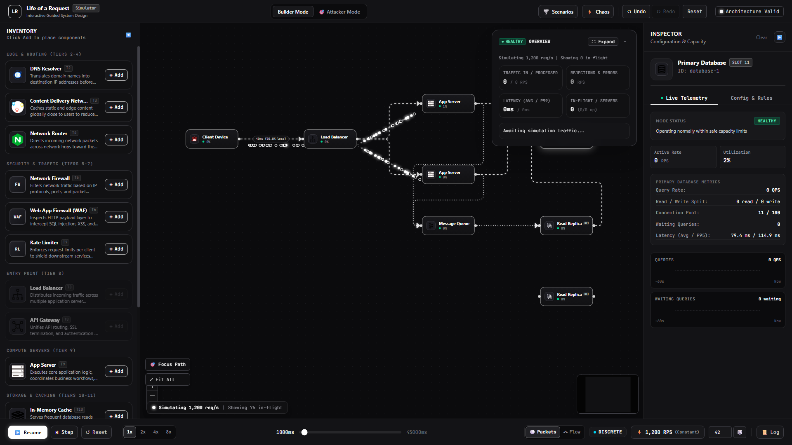
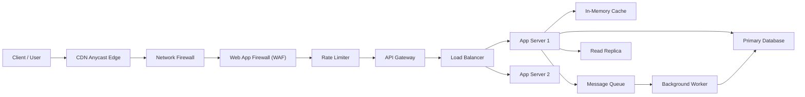

# Life of a Request (Interactive System Design Simulator)

> An interactive, educational distributed systems simulator. Architect cloud systems with drag-and-drop primitives, simulate traffic from 10 to 1,000,000 requests per second, inject chaotic failures, deploy multi-layer edge defenses, and trace packets with bit-for-bit deterministic reproducibility.



---

## Key Features

- **16 Architectural Primitives**: Client, DNS, CDN Anycast Edge, Firewall, WAF, Token-Bucket Rate Limiter, API Gateway, Round-Robin/Least-Conn Load Balancer, App Server, In-Memory Cache (Redis), Message Queue (Kafka), Background Workers, Primary SQL Database, Read Replicas, and Sharding.
- **Dual Simulation Engines**:
  - **Discrete-Event Priority Queue** (&le; 1,000 RPS): Simulates every individual request event, lognormal service times, retry budgets, health-check probes, and packet canvas animations.
  - **Fluid Aggregate ODE Engine** (&gt; 1,000 to 1,000,000 RPS): Uses differential flow conservation equations to simulate 10 minutes of 1M RPS traffic in sub-second wall-clock time (< 200 ms).
- **Attacker Mode & Edge Defenses**: Run realistic multi-phase DDoS attacks (Volumetric Floods, Slowloris, HTTP Floods, Cache-Busting Scrapers) and deploy matching defense layers (CDN, Layer 3/4 Firewall, WAF, Rate Limiter) to protect origin servers.
- **Time-Travel & Determinism**: Scrub forward and backward through simulation time with bit-for-bit identical hashes, regardless of host machine speed or frame rates.
- **Performance & Web Worker**: The simulation runs decoupled in a dedicated Web Worker via native postMessage with lookahead buffering and zero UI-thread stutter.
- **Browser Persistence & Sharing**: In-house IndexedDB storage with localStorage fallback, project library, and share links compressed via native browser `CompressionStream` (deflate) into URL hashes.
- **Learning & Onboarding**: Welcome spotlight tour, 5 guided interactive tutorials, and a plain-language engineering glossary with dotted-underline tooltips.

---

## Architecture Flow



---

## Quickstart

### Prerequisites
- Node.js 20.x or higher
- npm 10.x or higher

### Installation & Run
```bash
# Clone the repository
git clone https://github.com/subhamdas29/SystemDesign.git
cd SystemDesign

# Install dependencies
npm install

# Start development server
npm run dev
```

### Verification & Testing
```bash
# Run unit and integration test suite (52 test suites, 198+ tests)
npm test

# Run performance benchmark suite (1M RPS, discrete, memory, render cost)
npm run bench

# Verify component icon assets
npm run check:resources

# Typecheck and production bundle build (< 300 KB gzipped)
npm run build
```

---

## Performance Targets & Results

| Benchmark | Target | Measured Result | Status |
| :--- | :--- | :--- | :--- |
| **1M RPS 10-Min Aggregate Simulation** | < 2,000 ms wall-clock | **~195 ms** (600M requests) | **PASS ✓** |
| **1,000 RPS 10-Sec Discrete Simulation** | < 500 ms wall-clock | **~366 ms** (10k requests) | **PASS ✓** |
| **Memory Boundedness (10-min run)** | < 50 MB net heap growth | **~1.2 MB** | **PASS ✓** |
| **Engine Dispatch Latency** | < 2.0 ms per step | **~0.78 ms** | **PASS ✓** |
| **200 Packets Frame Computation Cost** | < 4.0 ms (60 FPS budget) | **~0.03 ms** | **PASS ✓** |
| **Production Initial JS Bundle** | < 300 KB gzipped | **267.44 kB** | **PASS ✓** |

---

## Keyboard Shortcuts

| Shortcut | Action |
| :--- | :--- |
| `Space` | Play / Pause simulation |
| `S` | Step forward one discrete event |
| `R` | Reset simulation to t = 0 |
| `1` / `2` / `4` / `8` | Set simulation speed |
| `?` | Toggle keyboard shortcuts overlay |
| `Esc` | Close active dialog, modal, or drawer |
| `Ctrl+Z` / `Cmd+Z` | Undo architecture graph change |
| `Ctrl+Y` / `Cmd+Y` | Redo architecture graph change |

---

## License

ISC License. Built for distributed systems engineers, architects, and students.
